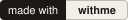

# withme-starter

[](https://github.com/vibe-with-me/withme-starter/actions/workflows/ci.yml)
[](docs/testing.md#coverage)
[](LICENSE)
[](https://www.npmjs.com/package/@vibewithme/nfc)
[](https://starter-demo.vibewithme.co/t/04BBBBBBBBBBBB)

**Find your people in what you love to do.**

An open-source starter for apps where people meet in person around
something they love: tap someone's tag or scan their code, nothing to
install, and you stay connected long after the moment that brought you
together. It ships as a web app and an iOS and Android app over one API,
ready to remix.

It grew out of [Vibe With Me](https://vibewithme.co), for the people you
meet at shows. Golf is my other passion, so the first remix is
[Golf With Me](https://github.com/vibe-with-me/golf-with-me). This repo is
a way to remix the idea for whatever you love.

<table>
  <tr>
    <td align="center" width="25%">
      <picture>
        <source media="(prefers-color-scheme: dark)" srcset="docs/images/readme/1-card-dark.png">
        
      </picture>
      <br><sub>A tap or scan opens their card</sub>
    </td>
    <td align="center" width="25%">
      <picture>
        <source media="(prefers-color-scheme: dark)" srcset="docs/images/readme/2-request-dark.png">
        
      </picture>
      <br><sub>They accept your request</sub>
    </td>
    <td align="center" width="25%">
      <picture>
        <source media="(prefers-color-scheme: dark)" srcset="docs/images/readme/3-connected-dark.png">
        
      </picture>
      <br><sub>Connected: their links unlock</sub>
    </td>
    <td align="center" width="25%">
      <picture>
        <source media="(prefers-color-scheme: dark)" srcset="docs/images/readme/4-events-dark.png">
        
      </picture>
      <br><sub>Events: discover gatherings, or see yours</sub>
    </td>
  </tr>
</table>

**Why.** *Join or Die*, the documentary about Robert Putnam's *Bowling
Alone*, makes the case that the clubs and leagues that used to build
social capital have thinned out, and that much of what replaced them
online is built for scrolling, not meeting people. This starter is a small
push the other way: every connection starts with two people in the same
place, doing something they both love. Someone out there is the right
person to build the run club or climbing gym version, and they shouldn't
need a company behind them to do it.

## What you could build

Every remix makes the same two moves: rename the gathering, and add a
couple of fields to the card. The skills exist because those moves repeat.

| Idea | The gathering becomes | On the card | Where the tag lives |
| --- | --- | --- | --- |
| Run With Me | a run (distance, pace group) | pace, home club | bib, water bottle |
| Golf With Me | a round (course, tee time) | handicap, home course | bag tag, ball marker |
| Tailgate With Me | a tailgate (lot, kickoff) | team, signature dish | cooler, koozie |
| Climb With Me | a session (wall, grade range) | grade, usual night | chalk bag |
| Walk With Me | a walk (park, time) | dog's name and breed | collar tag |
| Read With Me | a meeting (book, chapter) | currently reading | bookmark |

Ways to reach someone (a phone number, an Instagram handle) are already built
in as Links, which only your connections see.

## What's in the box

A working product, not a template:

- **Tags and the card.** Each tag carries one permanent URL; what it
  points at lives in the database, so you can re-point it forever. A
  stranger sees only your card: name, photo, bio, and which platforms
  you're on.
- **The handshake.** Connect, accept, connected. Your links unlock for
  connections only. Connect at a gathering you both joined and your
  connections list shows which one.
- **Gatherings.** An Events tab to discover gatherings or see yours, a
  headcount, Add to calendar, and a who's-going list that shows only
  people you know.
- **Safety built in.** Blocks, reports, account deletion, and three
  transactional push notifications, nothing more.
- **Web and mobile.** A TanStack Start web app and an Expo app over one
  typed API on Cloudflare Workers, with Supabase underneath.
- **Skills.** Runbooks in [`.agents/skills/`](.agents/skills/) that walk
  an AI coding agent, or you, through turning it into your app.

[Building blocks](docs/building-blocks.md) tours the code;
[the glossary](docs/glossary.md) defines the words.

## Try the live demo

Open [starter-demo.vibewithme.co/t/04BBBBBBBBBBBB](https://starter-demo.vibewithme.co/t/04BBBBBBBBBBBB)
in any phone's browser: it's what a tap on Ada's tag shows, nothing to install.

## Try it locally

Needs [Bun](https://bun.sh), [Docker](https://www.docker.com/products/docker-desktop/)
(running), and the [Supabase CLI](https://supabase.com/docs/guides/cli)
2.118 or newer. No cloud accounts, and about ten minutes.

```sh
git clone https://github.com/vibe-with-me/withme-starter.git
cd withme-starter
bun install
cp apps/api/.dev.vars.example apps/api/.dev.vars
cp apps/web/.env.example apps/web/.env
bun run db:start
bun run db:seed
bun run dev
```

Then open `http://localhost:3000/t/04BBBBBBBBBBBB` to tap Ada's tag, or
sign in as `ada@demo.withme.local` / `withme-demo-1`. Mobile, tests, and
fixes for a first run that goes wrong are in
[Local development](docs/local-development.md).

## Make it yours: Run With Me in eight skills

Each skill is a Markdown runbook with a checkpoint after every step.
[docs/run-with-me.md](docs/run-with-me.md) walks the whole run with the
prompt for each step; [docs/agent-prompt.md](docs/agent-prompt.md) hands
it to an agent in one go.

1. **`design-direction`** (optional): a look for the domain.
2. **`make-it-yours`**: your name, colors, fonts and app identity.
3. **`customize-gathering`**: a gathering becomes a run, with a distance.
4. **`extend-profile`**: a pace on the card, and fields only connections see.
5. **`add-destination-type`** (optional): a tag that opens today's route map.
6. **`provision-tags`**: tags for the first Saturday.
7. **`go-live`**: deploy to Supabase and Cloudflare, and ship mobile.
8. **`add-marketing-site`**: a front door, with the privacy pages app stores ask for.

None of these moves a privacy boundary, and the tests stay green after each.
What the tests cover and how to add your own: [Testing](docs/testing.md).

For a feature no skill covers, run [`feature-dev`](.agents/skills/feature-dev/SKILL.md):
it gates design, plan, tests per layer and a look at the running app
before the PR. Your fork's choices (branch prefix, tracker, who merges) go
in its [`settings.md`](.agents/skills/feature-dev/settings.md).

## The promises your users get

The hard part is done: renaming and restyling a fork moves no boundary,
so you don't rebuild trust and safety. A feature you add brings its own
policies and tests, which the skills walk you through. The promises below
are enforced in Postgres row-level security and proven by 70+ policy
tests. [The safety model](docs/safety-model.md)
explains each one.

- **Nobody can list your users.** A card is reachable only by a tap, a
  scan, or a connection. No search, no directory.
- **Blocks are absolute and invisible.** A blocked person sees exactly
  what a stranger sees.
- **Connections are mutual.** Either side can end one, quietly.
- **Who's going stays private.** Gatherings are listed; the member list
  shows you only your connections.
- **Scans are privacy-default.** A visit records a time, a user agent,
  and whether it was a tap or a scan. No location, no IP.
- **Deleting an account deletes everything,** and its tags return to
  unclaimed.

## Go further

- [Deploy](.agents/skills/go-live/SKILL.md): one platform, Cloudflare plus Supabase; free tiers cover a demo.
- [NFC tags](docs/nfc-tags.md): the chip, the URL, encoding, and why the domain you encode is forever.
- [Merch](docs/merch.md): accessories for your vertical, sourced and encoded, sold from your own store.
- [The stack, and why](docs/stack.md): each choice and what it costs. The stack is fixed in this repo; fork freely.
- [The slice](docs/the-slice.md): the order every change follows, from contract to end-to-end test.
- [Staying current](docs/staying-current.md): merge the starter's updates into your fork.
- [All docs](docs/README.md).

## What this is not

No matching, no recommendations, no people feeds. The Events tab is a
bulletin board of your own domain's gatherings, in time order. Software
that decides who you should meet is a different product, and the
promises above depend on not building one.

The handshake layer is free and open, permanently. To pay for itself, a
community can sell its own gear instead: almost any accessory can carry a
tag, with no ads and no data sold. That's how Vibe With Me runs,
at [vibewithme.co/shop](https://vibewithme.co/shop). The optional Merch tab
links to a fork's own store.

## Made something with it?

Add the badge to your fork's README so the next builder finds the starter:

[](https://github.com/vibe-with-me/withme-starter)

```md
[](https://github.com/vibe-with-me/withme-starter)
```

## Contributing

Issues and PRs are welcome, maintained on a best-effort basis; v0.x means
breaking changes. Help is wanted most in two places: admin tooling for the
people who run a community
([#100](https://github.com/vibe-with-me/withme-starter/issues/100)), and a
real visual identity forks can build on
([#101](https://github.com/vibe-with-me/withme-starter/issues/101)). Start with [CONTRIBUTING.md](CONTRIBUTING.md), and report
vulnerabilities privately as [SECURITY.md](SECURITY.md) describes.

## License

MIT for the code. The Vibe With Me name and marks are not covered by
the license: [TRADEMARKS.md](TRADEMARKS.md) says what forks may call
themselves, including the "[Something] With Me" pattern.
