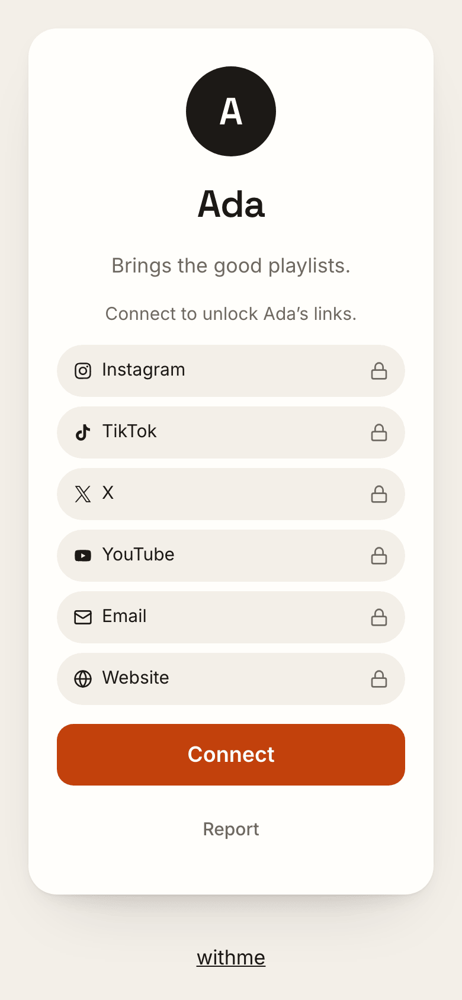
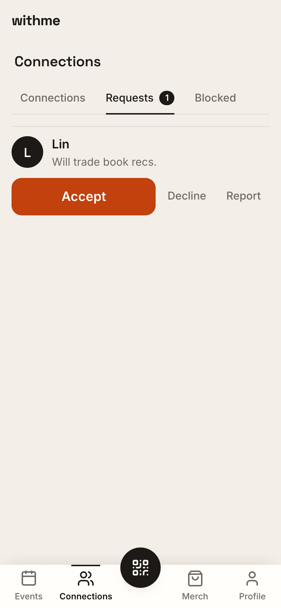
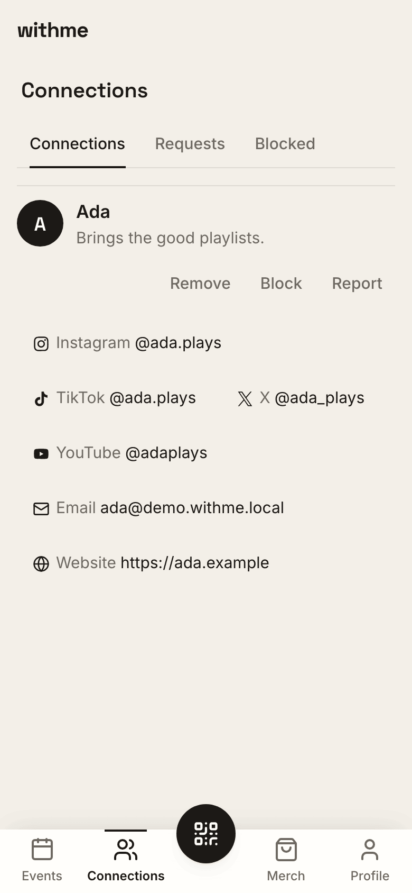
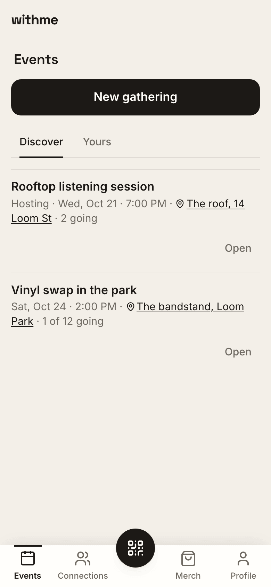

# withme-starter

[](https://github.com/vibe-with-me/withme-starter/actions/workflows/ci.yml)

**Find your people in what you love to do.**

withme-starter grew out of [Vibe With Me](https://vibewithme.co), made
for the people you meet at shows: tap their tag or scan their code at a
concert or a festival, no app needed, and stay connected with the stranger
who loved the same set you did. This repo
is a way to remix that idea for whatever you love. Live music is where it
started. Golf is my other passion, so the first remix is
[Golf With Me](https://github.com/vibe-with-me/golf-with-me): the same
handshake, with rounds instead of shows and a handicap on the card. Read
that repo to see how a finished fork is structured.

This repo is the open-source starter for apps where people meet in
person around something they love. Someone taps an NFC tag (on a keychain,
a bib, a table, a door), or scans the QR code on the other person's phone,
and the other person's card opens. Two taps later, they are connected. A host can point a tag at a gathering so the tap
is the invitation.

It ships as a working product: a web app, a mobile app, an API, a database
with its privacy rules already written, and a set of **skills** that walk an
AI coding agent (or you) through turning it into *your* app. Golf club,
run club, tailgate crew, climbing gym, dog park, book club, pickleball
league: the handshake is the same, and the starter is built so that only
the vocabulary and the look need to change.

The stack is opinionated and we like it that way: TanStack Start, Hono,
oRPC, Cloudflare Workers, Supabase, Bun. [Why those](docs/stack.md) is
written down, and the choices are not up for substitution in this repo.
Fork freely.

<table>
  <tr>
    <td align="center" width="25%">
      <picture>
        <source media="(prefers-color-scheme: dark)" srcset="docs/images/readme/1-card-dark.png">
        
      </picture>
      <br><sub>A tap or scan opens their card</sub>
    </td>
    <td align="center" width="25%">
      <picture>
        <source media="(prefers-color-scheme: dark)" srcset="docs/images/readme/2-request-dark.png">
        
      </picture>
      <br><sub>They accept your request</sub>
    </td>
    <td align="center" width="25%">
      <picture>
        <source media="(prefers-color-scheme: dark)" srcset="docs/images/readme/3-connected-dark.png">
        
      </picture>
      <br><sub>Connected: their links unlock</sub>
    </td>
    <td align="center" width="25%">
      <picture>
        <source media="(prefers-color-scheme: dark)" srcset="docs/images/readme/4-events-dark.png">
        
      </picture>
      <br><sub>Events: discover gatherings, or see yours</sub>
    </td>
  </tr>
</table>

---

## What you get on day one

Everything below works in the demo you can run locally in about ten
minutes ([Try it](#try-it-locally)).

| Building block | What it does for your users |
| --- | --- |
| **Tags** | Each physical tag carries one permanent URL, `https://<your-domain>/t/{UID}`. Where a tap lands, the tag's **destination**, lives in the database: your card by default, or a gathering you're in, so the tap becomes the invitation. Re-point a tag forever without touching the sticker; a fork can add its own destination types (the `add-destination-type` skill). |
| **The card** | A name, a photo, a short bio. The only thing a stranger sees after a tap or a scan. Reachable by tapping a tag, scanning a code, or through an existing connection, never by browsing. |
| **The handshake** | Tap or scan → "Connect" → the other person accepts → you are connected. Requests expire after a week. Either side can remove a connection, quietly. |
| **Gatherings** | A host creates one ("Rooftop listening session") and everyone in the domain sees it in the Events tab: title, time, place, a headcount. Who's going shows only the people you have connected with. Point your tags at a gathering and a tap shows your card plus the invite. No browse surface for people, ever. |
| **Blocks** | Absolute and invisible. A blocked person sees exactly what a stranger sees, and gets no signal that anything happened. |
| **Notifications** | Three pushes on the phone, and nothing else, ever: someone sent you a request, someone accepted yours, people joined your gathering. Off until you turn them on; one switch in Profile turns them off. The database sends them, so no way of calling the app skips the block check. |
| **Profile & account** | Photo upload, "My tags" (re-point or turn off), account deletion that cascades through everything and releases your tags. |
| **Links** | Where you can be reached: Instagram, WhatsApp, a website, a phone number, one per platform from a picker. Seen only by the people you have connected with, never on the card. |
| **Web app** | The resolver page (`/t/{UID}`), sign in, claim a tag, and a four-tab shell: Events, Connections, Merch (optional), Profile, with a raised QR button that shows your code. |
| **Mobile app** | The same tabs and the same resolver over the same contract, in Expo. Reads NFC in a development build. |
| **One API** | Every client talks to one Hono + oRPC API on Cloudflare Workers. It runs every query as the signed-in user, never as an admin. |
| **The database** | Supabase (Postgres + Auth + Storage). Row-level security and a small set of security-definer functions enforce every rule above, with 70+ policy tests that *are* the spec. |
| **A redirect SDK** | `@vibewithme/nfc`: if all you want is "tag → URL" with scan logging, the SDK does that on its own. |

Each block is a real file you can open. [Building blocks](docs/building-blocks.md)
is the tour; [the glossary](docs/glossary.md) defines the words.

## What you could build with it

The starter is the generic version of [Vibe With Me](https://vibewithme.co).
The first remix, [Golf With Me](https://github.com/vibe-with-me/golf-with-me),
needed the same two moves every vertical needs: rename the gathering, add a couple of
profile fields. The skills exist because those moves repeat.

| Idea | The gathering becomes | Fields on the card | Fields only connections see | Where the tag lives |
| --- | --- | --- | --- | --- |
| Run With Me | a run (distance, pace group) | pace, home club | Strava handle (a new Link platform), phone (a Link) | bib, shoe tag, water bottle |
| Golf With Me | a round (course, tee time) | handicap, home course | phone (a Link) | bag tag, ball marker |
| Tailgate With Me | a tailgate (lot, kickoff) | team, signature dish | phone (a Link) | cooler, koozie |
| Climb With Me | a session (wall, grade range) | grade, usual night | handle (a Link) | chalk bag, membership card |
| Walk With Me | a walk (park, time) | dog's name and breed | phone (a Link) | collar tag |
| Read With Me | a meeting (book, chapter) | currently reading | email (a Link) | bookmark |
| Trivia With Me | a team table | team name | handle (a Link) | table tent at the bar |

Every connections-only field above is a way to reach someone, and the
starter already ships those as Links (Profile → Links: a phone number, an
email, a handle on most services), seen only by connections. A new
service is one more Link platform; `extend-profile`'s connections tier is
for what is not a link (a shirt size, a postcode).

The pattern is the same every time: **a gathering with your nouns, a card
with your fields, a tag where your people already are.** The
[Run With Me walkthrough](#worked-example-run-with-me-skill-by-skill)
below does one of these end to end.

## Try it locally

No cloud accounts needed. Prerequisites: [Bun](https://bun.sh),
[Docker](https://www.docker.com/products/docker-desktop/), and the
[Supabase CLI](https://supabase.com/docs/guides/cli) version 2.118 or
newer. Start Docker before you begin.

```sh
git clone https://github.com/vibe-with-me/withme-starter.git   # or your fork
cd withme-starter
bun install
cp apps/api/.dev.vars.example apps/api/.dev.vars
cp apps/web/.env.example apps/web/.env
bun run db:start        # Supabase local on ports 553xx; the first run downloads images
bun run db:seed         # demo users + tags
bun run dev             # api on :8786, web on :3000
```

Then play the demo:

- `http://localhost:3000/t/04BBBBBBBBBBBB` is Ada's tag. It opens her
  profile card, with Connect.
- `http://localhost:3000/t/04AAAAAAAAAAAA` is an unclaimed tag. Sign up
  and claim it.
- Sign in as `ada@demo.withme.local` / `withme-demo-1` to see her
  gathering, her pending request from Lin, and her tags.

On a machine that has run the starter or another fork of it before,
`db:start` may print "Starting database from backup": the local stack is
named after `project_id` in `supabase/config.toml`, so a fresh clone
picks up the old checkout's database, migrations and all. Run
`bun run db:reset` before `db:seed` to rebuild it from this clone's
migrations.

If `db:start` says a port is already allocated, something else holds
553xx, usually another project's Supabase stack: stop it first
([Local development](docs/local-development.md#when-something-goes-wrong)
has the commands).

Mobile, tests, ports, and the fixes for the two or three things that go
wrong on a fresh machine are in [Local development](docs/local-development.md).
What the tests cover and how to add your own: [Testing](docs/testing.md).

## Worked example: Run With Me, skill by skill

Say you run a Saturday morning run club and want an app where a tap on
someone's bib connects you, and a tap on the sign at the start line joins
you to today's run. Here is how you get there with the skills in
[`.agents/skills/`](.agents/skills/). Each skill is a Markdown runbook an
agent such as Claude Code can execute, with a checkpoint at the end of
every step; you can also read them and do the steps yourself.

The full version, with the agent prompts, every file that changes, and the
checks at each step, is [docs/run-with-me.md](docs/run-with-me.md). To
hand the whole run to an agent at once, start it with
[docs/agent-prompt.md](docs/agent-prompt.md).

**0. Fork and run the demo.** Everything above, then the verification
gate once (the tests need the local service-role key exported first:
[the one line](docs/local-development.md#the-service-role-key)). You now
have `withme`, working, on your machine. Add the starter as an
`upstream` remote now; its later fixes reach your fork as an ordinary
`git merge` ([Staying current](docs/staying-current.md)). For a private
app, clone and push to a new private repository instead of forking
([step 0](docs/run-with-me.md#step-0-fork-and-run-the-demo) has the
commands).

**1. `design-direction` (optional): a look for the domain.**
"A neighborhood run club. Mood: dawn, asphalt, Saturday." The skill runs
Claude's `/design` on the starter's own three screens and reduces the
result to a sheet, `docs/brand-direction.md`, with the colors, fonts, and
copy that the next skill asks for. Skip it if you already have a brand.

**2. `make-it-yours`: the rebrand.** Wordmark `runwithme`, display name
"Run With Me", one accent color, two fonts, the app's bundle id and
deep-link scheme, the worker names. This is a token swap, not a redesign:
every brand-bearing value sits behind a seam the skill walks. No feature
code changes.

**3. `customize-gathering`: a gathering becomes a run.** The tab says
"Runs", the URL is `/runs`, and a run gains a `distance` field ("5K",
"10 mi") that shows on the card a tapper sees before joining. The skill
walks the change through the contract, a migration, the tests, the API,
web, mobile, and the end-to-end suite, in that order. Internal names stay
`gathering`; only what users read changes.

**4. `extend-profile`: your fields, in two tiers.** A card-tier `pace`
("easy, 10:00/mi") that anyone who taps your bib can see, and a
connections-tier `strava_handle` that only people you accepted can read.
The second tier is the part forks get wrong alone, so it was built for
real, tests first, before it was written down. Optionally, require `pace`
before the app opens.

**5. `add-destination-type` (optional): a tag that points at a route.**
Grow the destination union with `{ type: 'link', url }` so the tag on the
start-line sign can send people to today's route map. The skill's worked
example is exactly this type.

**6. `provision-tags`: tags for the first Saturday.** Twenty-five random
UIDs, an encode list of `https://app.runwithme.example/t/{UID}` URLs, and a
printable sheet. Encode with any NFC writer app, lock the tags, hand them
out. First tap claims.

**7. `go-live`: ship it.** Hosted Supabase, the API worker, the web
worker, an EAS update for mobile. Every pothole in the runbook was hit on
a real deploy.

**8. `add-marketing-site`: a front door.** A static Astro site at
`runwithme.example` (the app lives at `app.runwithme.example`, which the
tags encode) that says what the bib tag does, plus the privacy and
support pages the app stores ask for. It imports the app's tokens and
card, so it wears your brand with no styles of its own, and it ships no
JavaScript and no analytics.

At the end you have Run With Me: a run club app with your brand, your
nouns, your fields, and the same privacy promises as the starter, because
none of the steps above moved a boundary. The verification gate
(`bun run lint && bun run typecheck && bun run test`) is green after every
skill.

## How it fits together

```
NTAG213 tag ──encodes──▶ https://<your-domain>/t/{UID}
                              │
                  apps/web (Workers) renders "the card" server-side
                              │ typed oRPC client
                  apps/api (Workers) Hono + oRPC
                              │ the caller's JWT, never a service key
                  Supabase (Postgres + RLS + Auth + Storage)
```

The idea that makes it work: **the UID on the tag is permanent; what it
points at is a row in the database.** Encode once, lock the tag, and
re-point it from the app for as long as the domain exists.

| Where | What lives there |
| --- | --- |
| [`packages/contract`](packages/contract) | The single source of truth: oRPC contracts and Zod schemas. Two routers, `public` (resolve, claim, log a scan) and `app` (everything signed in). Every other package derives its types from here. |
| [`apps/api`](apps/api) | The one backend. Verifies Supabase JWTs, runs every query under the caller's identity, rate-limits anonymous taps and scans at the edge. |
| [`apps/web`](apps/web) | TanStack Start on Workers. Loaders call the API through the typed client; the web app owns no data access. `/t/$uid` is the product. |
| [`apps/mobile`](apps/mobile) | Expo + Expo Router. Same tabs, same resolver, same contract. |
| [`packages/db`](packages/db) | Supabase client, generated types, query helpers, and the RLS test suite. |
| [`packages/nfc-sdk`](packages/nfc-sdk) | `@vibewithme/nfc`, the standalone redirect SDK; its `client` entry wraps this API's public contract. |
| [`supabase/`](supabase) | Migrations, policies, the seed, and the tag-provisioning script. |

Every change enters the codebase as one vertical slice in a fixed order:
contract → migration + RLS → RLS tests → API → web → mobile → e2e.
[docs/the-slice.md](docs/the-slice.md) is that map, with the real file
playing each role today. The skills are the slice applied to one concern.

## The promises your users get for free

These hold in every fork that extends through the skills, because they
are enforced in the database and re-stated by a test, not promised by UI
code. [docs/safety-model.md](docs/safety-model.md) explains each one and
points at the test that proves it.

- **Nobody can list your users.** A card is reachable only by tapping a
  tag, scanning a code, or through a connection. There is no search, no directory, no
  sequential id, and no error message that leaks whether a row exists.
- **Blocks are absolute and invisible.** A blocked person gets the same
  response as a stranger, down to the rate limiter.
- **Connections are mutual.** They exist only when a request is accepted,
  and either side can end one without notifying the other.
- **Gatherings are listed; who's going is not.** Everyone signed in to
  the domain sees every gathering its host lists to everyone, and its
  headcount; a host can instead keep one to their connections, and cap
  it with a number of spots. The member list shows you only yourself and
  your accepted connections; joining never reveals your card to a
  stranger. A gathering hidden from you, by a block or by its host,
  looks like one that does not exist.
- **Scans are privacy-default.** A tap stores a user-agent string and a
  timestamp. No GPS, no IP, no fingerprinting: those columns do not exist.
- **Pushes are transactional and say only what you could already see.**
  A request, an acceptance, people joining your gathering: nothing
  else, off until you turn them on, and never a hint that a block
  exists.
- **Photos cannot point off-site.** A profile stores a path inside your
  own Storage bucket, never a URL.
- **Deleting an account deletes everything.** Connections, requests,
  blocks, hosted gatherings, photos, and scan history go, and your tags
  return to unclaimed.

## Encoding NFC tags

A tag carries one URL, `https://<your-domain>/t/{UID}`, written as an
NDEF URI record and then locked read-only. The UID is random by default
(`bun run db:provision` generates it) because an unclaimed tag belongs to
whoever presents its UID first. Any NFC writer app works (NXP TagWriter is
the usual one). The [`provision-tags`](.agents/skills/provision-tags/SKILL.md)
skill is the runbook; [docs/nfc-tags.md](docs/nfc-tags.md) explains the
chip, the URL, random versus chip UIDs, and why the domain you encode is
forever.

## Deploying

One platform: Cloudflare for both workers, Supabase for the database. The
[`go-live`](.agents/skills/go-live/SKILL.md) skill is the step-by-step
runbook; the short version is:

1. Create a Supabase project, `supabase link`, `supabase db push`.
2. In the Supabase dashboard, set your site URL and
   `https://<your-web-domain>/auth/callback` as a redirect URL. For
   phone sign-in, turn on the Phone provider with your Twilio Verify
   credentials ([docs/stack.md](docs/stack.md#twilio-verify-phone-sign-in-codes)).
3. Put the API's config in as Worker **secrets** (`SUPABASE_URL`,
   `SUPABASE_PUBLISHABLE_KEY`, `CORS_ORIGIN`), so a deploy can never
   clobber them.
4. Write `apps/web/.env.production` with the `VITE_*` values from
   `.env.example` pointed at your deployed API and project.
5. `bun run deploy`. The API worker deploys first; the web worker reaches
   it through a service binding, and Turborepo enforces the order.
6. Encode a tag, tap it, claim it.

Later redeploys can run from GitHub Actions: `.github/workflows/deploy.yml`
ships off, and `go-live` → Automated redeploys turns it on.

A public website for the fork, with the privacy and support URLs the app
stores ask for, is a third Worker: the
[`add-marketing-site`](.agents/skills/add-marketing-site/SKILL.md) skill,
run after `go-live`. Decide its hostname before you encode tags
([docs/nfc-tags.md](docs/nfc-tags.md#the-domain-is-forever)).

Free tiers cover a demo. [docs/stack.md](docs/stack.md) covers what each
platform costs once it is real.

## The stack, briefly

| Choice | What it buys you |
| --- | --- |
| **Bun** workspaces + Turborepo | One install, one lockfile, one `bun run dev`. |
| **TypeScript + Zod + oRPC** | Change a schema in `packages/contract` and every client fails to compile until it agrees. |
| **Hono on Cloudflare Workers** | The API and the web app deploy to one account, start cold in milliseconds, and the free tier is generous. |
| **TanStack Start** | Server-rendered resolver page (a tap or a scan must land fast and unbreakable) with typed file routes. |
| **Expo + Expo Router** | The mobile app mirrors the web routes file for file, and ships updates over the air. |
| **Supabase** | Postgres with row-level security, auth, and storage, and a local stack in Docker so tests run against the real thing. |

The longer version, including the constraints each choice brings (Workers
need Workers-compatible dependencies; LogTape, not Pino) is in
[docs/stack.md](docs/stack.md). Framework ports (Next.js, Express,
another database) are out of scope for this repo; forks are welcome to
make different choices, but the skills assume these.

## What this is not

The starter's job is the moment after a tap or a scan. It deliberately has
no matching, recommendations, people feeds, or aggregation of events from
elsewhere; the Events tab is a time-ordered list of your own domain's
gatherings, a bulletin board, not a recommendation. Software that decides
who you should meet is a different product with different incentives, and
the no-enumeration promise above depends on not building one. Extensions that rank, recommend, aggregate, or monetize are
off-thesis for this repo; a fork can build them, but the skills will not.

The commercial line, stated on day one: **the handshake layer is free and
open, permanently.** Vibe With Me sells printed, encoded, and locked tags
for its own app at [vibewithme.co/shop](https://vibewithme.co/shop), which
is a good reference store. A fork runs its own store and fulfillment. The
Merch tab in the app is a pointer to a store URL you configure, never a
cart.
[docs/merch.md](docs/merch.md) shows a fork running its own: accessories
for the vertical (ball markers, bib clips, collar tags), tags encoded by
GoToTags from the starter's encode list, a Shopify store behind the tab.

## Contributing

- Issues and PRs welcome; maintained on a best-effort basis, no support SLA.
- v0.x: breaking changes expected.
- `apps/api` runs on Cloudflare Workers: Workers-compatible dependencies
  only.
- Lint is `oxlint --deny-warnings`; CI runs lint, typecheck, build, the
  RLS suite against Supabase local (the `ci` check), and the Playwright
  suite (the `e2e` check). See [docs/testing.md](docs/testing.md).
- [docs/skills-roadmap.md](docs/skills-roadmap.md) records which skills
  exist, which were deliberately skipped, and why.

## License

MIT for the code. The Vibe With Me name and marks are not covered by
the license: [TRADEMARKS.md](TRADEMARKS.md) says what forks may call
themselves, including the "[Something] With Me" pattern.
